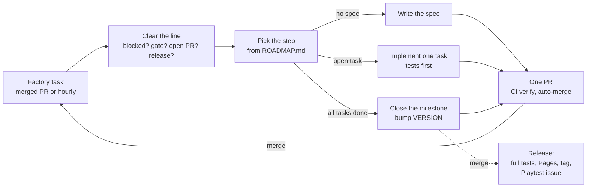

# Biosphere

**A browser game about evolving creatures in a shared micro-ocean, built entirely by AI agents.**

▶ **Play it at https://resner.github.io/Biosphere/** (no install or account needed), or explore creature genetics in the [Creature Lab](https://resner.github.io/Biosphere/lab.html).

In Biosphere you start as a single cell hatched from unique DNA, in one continuous body of water that you share with everyone else playing. You swim, eat, grow and try to survive. Every other creature you meet is another player, because there are no computer-controlled creatures. When two players mate, each gets their own offspring, whose body is grown from both parents' genes. When you die, you carry on as one of your descendants or ancestors, so over time you're playing a whole lineage rather than a single creature.

The game runs peer to peer in the browser, rendered in WebGL with a look inspired by macro photography of plankton. A small serverless backend keeps lineages honest and verifiable. The game is still being built and released milestone by milestone, so what you can play today is an early version of the plan in [docs/ROADMAP.md](docs/ROADMAP.md).

What makes this repository unusual is how it's built: Claude Code agents plan, write, test and release the game on their own, as described below.

## The agent loop

Nobody writes this game's code by hand. The owner wrote a [brief](docs/BRIEF.md), and Claude Code turned it into a roadmap, architecture decisions and a toolchain. Since then an unattended "factory" of Claude Code runs has built the game one step at a time. The owner steers by playing the releases and opening issues.

### One run, one step, one PR

Each run executes the [`/next`](.claude/skills/next/SKILL.md) skill:

1. **Clear the line.** Stop if a `Blocked:` issue waits for the owner, a `gate` playtest has no reply yet, or another run is working. Wait for a release in progress. Handle Dependabot PRs and the owner's issues and playtest comments.
2. **Claim the step** with a small draft PR. This is the lock that stops parallel runs from doing the same work. CI also fails any factory PR while a lower-numbered one is open.
3. **Do the step**, picked from [docs/ROADMAP.md](docs/ROADMAP.md):
   - **[spec](.claude/skills/spec/SKILL.md)**: turn the next milestone's outline into tasks, each with acceptance tests (Opus).
   - **task**: write the acceptance tests first and watch them fail, implement, then run `npm run check`, `/simplify` and `/code-review` (Sonnet).
   - **[milestone](.claude/skills/milestone/SKILL.md)**: verify everything, review against the spec and rubric, prune, and bump `VERSION` (Opus).
4. **Ship**: mark the PR ready and auto-merge it once the required CI check `verify` (lint, typecheck, unit tests, build, E2E in headless Chromium) is green. Nobody reviews PRs, so the tests are the gate.

When a factory PR merges, the scheduled task's GitHub trigger starts the next run right away, so the factory works back to back until the usage limit. An hourly schedule restarts it after limits, gates or failures.

### Releases and playtests

A `VERSION` bump merged to `main` runs the full test suite and deploys the Worker and the game to GitHub Pages. It then tags the release, and the factory opens a `Playtest: v…` issue with what changed and what to try. Fun, feel and real-world networking are the owner's call. Milestones marked `gate` (M2, M5, M6, M7, M14) wait for the owner's reply before the factory moves on.

### Steering the factory

The repository is public, so only issues and comments from the owner's account steer the factory. Anything else is ignored. The factory signs its own posts with a footer, which is how it tells them apart.

- **Bug or idea:** open an issue, or comment on a `Playtest:` issue. Bugs are fixed test-first in the next run; ideas go into the right milestone, and the factory comments where.
- **`Blocked:` issues** ask for something only the owner can provide (a secret, an account, an open design question). Reply in the issue.
- **Change direction:** edit `docs/BRIEF.md` or `docs/ROADMAP.md` through a PR, or describe it in an issue.
- **Pause or resume:** disable or enable the scheduled task.

### Where things live

| Path | What |
|------|------|
| [docs/BRIEF.md](docs/BRIEF.md) | The original product brief |
| [docs/ROADMAP.md](docs/ROADMAP.md) | Milestones M0 to v1.0.0, status, outlines |
| [docs/DESIGN.md](docs/DESIGN.md) | How the game plays, with its numbers |
| [docs/specs/](docs/specs/) | Per-milestone tasks with acceptance tests and notes |
| [docs/decisions/](docs/decisions/) | Architecture and process decisions (ADRs) |
| [docs/art/](docs/art/) | Art-direction references (never shipped) |
| [docs/SETUP.md](docs/SETUP.md) | One-time GitHub, schedule and Cloudflare setup |
| [CLAUDE.md](CLAUDE.md), [.claude/](.claude/) | Instructions, quality rules, skills and hooks for the agents |

## Development

Node 22 or 24. Install with `npm ci`.

| Command | What it does |
|---------|--------------|
| `npm run dev` | Local dev server |
| `npm run check` | Lint, typecheck and unit tests (under ~30 s) |
| `npm run build` | Static site into `dist/` |
| `npm run test:e2e` | Fast Playwright E2E against `dist/` (the PR gate) |
| `npm run verify` | Everything, including slow E2E (the release gate) |

To work by hand, start a Claude Code session in the repository and run `/next` to advance one step, or describe a fix. Keep each change to one PR.
