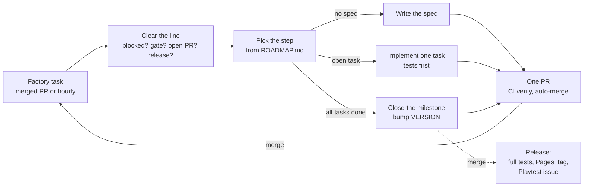

# Biosphere

**A peer-to-peer creature-evolution game in a living micro-ocean, playable in the browser.**

▶ **Play:** https://resner.github.io/Biosphere/ · 🧬 **Creature Lab:** https://resner.github.io/Biosphere/lab.html

You hatch a single cell from unique DNA and drift into one continuous body of water, from sunlit shallows down to dark, bioluminescent depths. You swim, feed, grow and avoid hazards, fight creatures of your own size and mate with other players. Every mating gives *both* players a distinct offspring whose body grows from the parents' genes by Mendelian rules. When you die, you continue as your pending offspring or your nearest surviving ancestor, so what you're really playing is your lineage.

There are no NPCs: every other creature in the water is another player. Claude Code builds the game as an unattended "factory" and releases it milestone by milestone (see [The agent loop](#the-agent-loop)).

## The game

### Survive and grow

Steer a translucent organism through the water, dash away from danger, and eat drifting detritus, nutrient globules, vent crystals and carrion. Food becomes energy, and spare energy becomes biomass: you grow, and the camera zooms out with you. Basal metabolism and every movement cost energy. Toxic plumes, currents, UV in the shallows and pressure in the deep each wear you down in their own way. Starving, poison or old age ends a life, and the death screen always says why.

### Bodies from DNA

Every creature carries a diploid genome. That genome grows into a body within fixed bounds, so every genome is viable: segments, fins, whips, paddles, spines, plates, jaws, antennae and inner organs. Form drives function. Anatomy sets how fast you swim and turn, what and how you eat, how you fight, and which hazards you tolerate. Every advantage has a cost, so no single build wins. Small whip-tailed cells thrive where big paddlers struggle, and the other way round. Rare alleles and combinations make striking creatures worth showing off. The Creature Lab lets you inspect bodies in plain words, mutate them and breed them.

### Mate and carry on

Mature creatures court other players, and mating happens only with consent. It costs both partners energy and biomass and starts a cooldown. Each partner receives a different offspring. Its genes are drawn by meiosis from both parents, and the random seed comes from a public beacon round that nobody knows in advance, so nobody can reroll a child. You can switch to your offspring at any time and leave the parent behind as a checkpoint. When you die, you return to your pending offspring or your nearest surviving ancestor. Breeding with close relatives expresses hidden harmful genes, so diversity pays.

### Fight fair

Creatures of comparable size can fight. Attacks come from your anatomy: bites, rams, stings and spines. You steer, pick a stance, choose a target and time a brace. Fights are refereed and deterministic, so every client sees the same outcome. Closing the tab doesn't end a fight: your creature fights on by its instincts until the fight is settled. The winner feeds on the loser, and what's left becomes carrion for everyone.

### A shared ocean

Players connect directly to each other. You spawn near other players of your size, see everyone who can affect you, and talk through filtered chat, emotes and pings. As you grow, your view widens and tiny creatures fade into ambient swarms. Players gather in habitats; new players hatch safely at their edge, and crowded areas split into instances.

### A lineage anyone can verify

Every life event (genesis, mating, birth, promotion, checkpoint, death, fight) is a signed record chained to the one before it. Anyone can verify a creature's whole ancestry back to its genesis, even when the original players are offline. Shareable creature cards show a verified creature and its family tree. Your identity is a key in your browser, and a recovery code moves it to another device.

### Controls

| Action | Mouse | Keyboard |
|--------|-------|----------|
| Steer | point where to go; the farther the cursor, the faster | WASD |
| Dash | — | Space |
| Court or accept | click a creature, then the button | E |
| Attack | click a creature in range | F |
| Stance, target, brace (in a fight) | HUD buttons, click, right button | 1–3, Tab, Shift |
| Chat, emote, ping | middle button pings | Enter, quick keys |
| Menu | — | Esc |

### How it works

- **Peer to peer.** Players connect directly over WebRTC. Each client simulates its own creature with a deterministic 30 Hz simulation (our own math and seeded random streams), so recorded inputs replay to the same result in every browser and in Node.
- **A minimal authority.** One Cloudflare Worker with a single SQLite Durable Object handles sessions, signaling, short-lived TURN relay credentials, the lineage ledger, the clock, commitments and admission. It runs no game loop and stays within the free tier.
- **Witnesses.** Peers picked by the public beacon referee and attest fights and matings. The authority checks them and settles when witnesses fail.
- **Honest randomness.** Genesis DNA and offspring are seeded from a future round of the public [drand](https://drand.love) beacon. Every commitment names its round before that round exists.
- **Rendering.** Three.js on WebGL2 with custom shaders. The look is macro photography of plankton: dark water, backlit translucent bodies, inner sparkle, shallow depth of field, caustics, and bioluminescence in the deep. Quality presets keep it smooth on ordinary laptops.

The plan and progress are in [docs/ROADMAP.md](docs/ROADMAP.md), the mechanics and their numbers in [docs/DESIGN.md](docs/DESIGN.md), and the architecture decisions in [docs/decisions/](docs/decisions/). The art direction comes from the references in [docs/art/](docs/art/).

## The agent loop

Nobody writes this game's code by hand. The owner wrote a [brief](docs/BRIEF.md), and Claude Code turned it into a roadmap, architecture decisions and a toolchain. Since then an unattended "factory" of Claude Code runs has built the game one step at a time. The owner steers by playing the releases and opening issues.

### One run, one step, one PR

Each run executes the [`/next`](.claude/skills/next/SKILL.md) skill:

1. **Clear the line.** Stop if a `Blocked:` issue waits for the owner, a `gate` playtest has no reply yet, or another run is working. Wait for a release in progress. Handle Dependabot PRs and the owner's issues and playtest comments.
2. **Claim the step** with a small draft PR. This is the lock that stops parallel runs from doing the same work. CI also fails any factory PR while a lower-numbered one is open.
3. **Do the step**, picked from [docs/ROADMAP.md](docs/ROADMAP.md):
   - **[spec](.claude/skills/spec/SKILL.md)**: turn the next milestone's outline into tasks, each with acceptance tests (Opus).
   - **task**: write the acceptance tests first and watch them fail, implement, then run `npm run check`, `/simplify` and `/code-review` (Sonnet).
   - **[milestone](.claude/skills/milestone/SKILL.md)**: verify everything, review against the spec and rubric, prune, and bump `VERSION` (Opus).
4. **Ship**: mark the PR ready and auto-merge it once the required CI check `verify` (lint, typecheck, unit tests, build, E2E in headless Chromium) is green. Nobody reviews PRs, so the tests are the gate.

When a factory PR merges, the scheduled task's GitHub trigger starts the next run right away, so the factory works back to back until the usage limit. An hourly schedule restarts it after limits, gates or failures.

### Releases and playtests

A `VERSION` bump merged to `main` runs the full test suite and deploys the Worker and the game to GitHub Pages. It then tags the release, and the factory opens a `Playtest: v…` issue with what changed and what to try. Fun, feel and real-world networking are the owner's call. Milestones marked `gate` (M2, M5, M6, M7, M14) wait for the owner's reply before the factory moves on.

### Steering the factory

The repository is public, so only issues and comments from the owner's account steer the factory. Anything else is ignored. The factory signs its own posts with a footer, which is how it tells them apart.

- **Bug or idea:** open an issue, or comment on a `Playtest:` issue. Bugs are fixed test-first in the next run; ideas go into the right milestone, and the factory comments where.
- **`Blocked:` issues** ask for something only the owner can provide (a secret, an account, an open design question). Reply in the issue.
- **Change direction:** edit `docs/BRIEF.md` or `docs/ROADMAP.md` through a PR, or describe it in an issue.
- **Pause or resume:** disable or enable the scheduled task.

### Where things live

| Path | What |
|------|------|
| [docs/BRIEF.md](docs/BRIEF.md) | The original product brief |
| [docs/ROADMAP.md](docs/ROADMAP.md) | Milestones M0 to v1.0.0, status, outlines |
| [docs/DESIGN.md](docs/DESIGN.md) | How the game plays, with its numbers |
| [docs/specs/](docs/specs/) | Per-milestone tasks with acceptance tests and notes |
| [docs/decisions/](docs/decisions/) | Architecture and process decisions (ADRs) |
| [docs/art/](docs/art/) | Art-direction references (never shipped) |
| [docs/SETUP.md](docs/SETUP.md) | One-time GitHub, schedule and Cloudflare setup |
| [CLAUDE.md](CLAUDE.md), [.claude/](.claude/) | Instructions, quality rules, skills and hooks for the agents |

## Development

Node 22 or 24. Install with `npm ci`.

| Command | What it does |
|---------|--------------|
| `npm run dev` | Local dev server |
| `npm run check` | Lint, typecheck and unit tests (under ~30 s) |
| `npm run build` | Static site into `dist/` |
| `npm run test:e2e` | Fast Playwright E2E against `dist/` (the PR gate) |
| `npm run verify` | Everything, including slow E2E (the release gate) |

To work by hand, start a Claude Code session in the repository and run `/next` to advance one step, or describe a fix. Keep each change to one PR.
