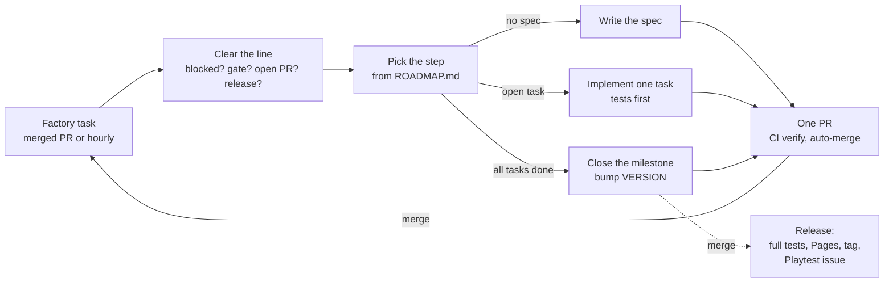

# Biosphere

**A peer-to-peer creature-evolution game in a living micro-ocean, playable in the browser.**

▶ **Play:** https://resner.github.io/Biosphere/ · 🧬 **Creature Lab:** https://resner.github.io/Biosphere/lab.html

You hatch a single cell from unique DNA and drift into dark, sunlit-to-abyssal water. You swim, feed, grow and avoid hazards. Later you fight creatures of your own size and mate with other players. Every mating gives *both* players a distinct offspring whose body is grown from the parents' genes by Mendelian rules. When you die, you continue as your pending offspring or your nearest surviving ancestor, so your lineage is what you're really playing.

There are no NPCs: every other creature in the water is another player. The game is built and released milestone by milestone by an unattended Claude Code "factory" (see [The agent loop](#the-agent-loop)).

## The game

### What you can do today (v0.4.0)

- **Swim and feed:** steer a translucent cell, dash, eat drifting food, grow (the camera zooms out as you do), and stay clear of toxic plumes. Starving or poisoning ends in a death screen that names the cause; then you hatch again.
- **Share a pond:** everyone who opens the link joins a pond of up to 24 players. You spawn near each other, see each other swim smoothly, compete for the same food, and use filtered chat, emotes and pings.
- **Procedural bodies:** each creature's DNA grows into its own body: shape, colour, pattern, mouth and tail. Anatomy changes how it swims, turns, eats and copes with toxins, and how big it can grow. The HUD shows your species name and rarity.
- **Creature Lab:** browse genesis creatures, read their traits in plain words, mutate them, breed two into eight offspring, and copy or load genomes.

### Controls

| Action | Mouse | Keyboard |
|--------|-------|----------|
| Steer | point where to go; the farther the cursor, the faster | WASD |
| Dash | — | Space |
| Chat | — | Enter |
| Emote, ping | middle button pings | T, G |
| Hatch (again) | button | Enter |

Courting (E) and fighting (F, stances 1–3, brace with Shift) arrive with their milestones.

### Where it's going

| Next | What it adds |
|------|--------------|
| v0.5.0 Authority and lineage core | Your creature and lifespan persist; genesis DNA from a public randomness beacon; recovery code |
| v0.6.0 Mating and offspring | Consent-based mating, two distinct offspring, lineage fallback on death |
| v0.7.0 Look, sound and performance | Creature look overhaul to the [art references](docs/art/), depth zones, procedural sound, quality presets |
| v0.8.0–v0.9.0 Encounters | Refereed real-time fights between comparable sizes that survive disconnects |
| v0.10.0–v0.14.0 Verifiable lineage, witnesses, one large world, scale | Anyone can verify a creature's ancestry; area of interest and size tiers; load-tested to 10,000 players |
| v1.0.0 | About 200 real players at once in Chrome, Edge, Firefox and Safari |

The full plan, with exit criteria for every milestone, is [docs/ROADMAP.md](docs/ROADMAP.md). The mechanics and their numbers are in [docs/DESIGN.md](docs/DESIGN.md).

### How it works

- **Peer to peer.** Players connect directly over WebRTC. Each client simulates its own creature with a deterministic 30 Hz simulation (our own math and seeded random streams), so recorded inputs replay to the same result in every browser and in Node.
- **A minimal authority.** One Cloudflare Worker with a single SQLite Durable Object handles sessions, signaling, short-lived TURN relay credentials and, from v0.5.0, the lineage ledger, clock and commitments. It runs no game loop and stays within the free tier.
- **Honest randomness and verifiable lineage.** Genesis DNA and offspring are seeded from a future round of the public [drand](https://drand.love) beacon, so nobody can reroll. Every life event is a signed record chained to the previous one.
- **Rendering.** Three.js on WebGL2 with custom shaders aims for the look of macro photography of plankton: dark water, backlit translucent bodies, shallow depth of field.

Architecture decisions are recorded as ADRs in [docs/decisions/](docs/decisions/).

## The agent loop

Nobody writes this game's code by hand. The owner wrote a [brief](docs/BRIEF.md), and Claude Code turned it into a roadmap, architecture decisions and a toolchain. Since then an unattended "factory" of Claude Code runs has built the game one step at a time. The owner steers by playing the releases and opening issues.

### One run, one step, one PR

Each run executes the [`/next`](.claude/skills/next/SKILL.md) skill:

1. **Clear the line.** Stop if a `Blocked:` issue waits for the owner, a `gate` playtest has no reply yet, or another run is working. Wait for a release in progress. Handle Dependabot PRs and the owner's issues and playtest comments.
2. **Claim the step** with a small draft PR. This is the lock that stops parallel runs from doing the same work. CI also fails any factory PR while a lower-numbered one is open.
3. **Do the step**, picked from [docs/ROADMAP.md](docs/ROADMAP.md):
   - **[spec](.claude/skills/spec/SKILL.md)**: turn the next milestone's outline into tasks, each with acceptance tests (Opus).
   - **task**: write the acceptance tests first and watch them fail, implement, then run `npm run check`, `/simplify` and `/code-review` (Sonnet).
   - **[milestone](.claude/skills/milestone/SKILL.md)**: verify everything, review against the spec and rubric, prune, and bump `VERSION` (Opus).
4. **Ship**: mark the PR ready and auto-merge it once the required CI check `verify` (lint, typecheck, unit tests, build, E2E in headless Chromium) is green. Nobody reviews PRs, so the tests are the gate.

When a factory PR merges, the scheduled task's GitHub trigger starts the next run right away, so the factory works back to back until the usage limit. An hourly schedule restarts it after limits, gates or failures.

### Releases and playtests

A `VERSION` bump merged to `main` runs the full test suite and deploys the Worker and the game to GitHub Pages. It then tags the release, and the factory opens a `Playtest: v…` issue with what changed and what to try. Fun, feel and real-world networking are the owner's call. Milestones marked `gate` (M2, M5, M6, M7, M14) wait for the owner's reply before the factory moves on.

### Steering the factory

The repository is public, so only issues and comments from the owner's account steer the factory. Anything else is ignored. The factory signs its own posts with a footer, which is how it tells them apart.

- **Bug or idea:** open an issue, or comment on a `Playtest:` issue. Bugs are fixed test-first in the next run; ideas go into the right milestone, and the factory comments where.
- **`Blocked:` issues** ask for something only the owner can provide (a secret, an account, an open design question). Reply in the issue.
- **Change direction:** edit `docs/BRIEF.md` or `docs/ROADMAP.md` through a PR, or describe it in an issue.
- **Pause or resume:** disable or enable the scheduled task.

### Where things live

| Path | What |
|------|------|
| [docs/BRIEF.md](docs/BRIEF.md) | The original product brief |
| [docs/ROADMAP.md](docs/ROADMAP.md) | Milestones M0 to v1.0.0, status, outlines |
| [docs/DESIGN.md](docs/DESIGN.md) | How the game plays, with its numbers |
| [docs/specs/](docs/specs/) | Per-milestone tasks with acceptance tests and notes |
| [docs/decisions/](docs/decisions/) | Architecture and process decisions (ADRs) |
| [docs/art/](docs/art/) | Art-direction references (never shipped) |
| [docs/SETUP.md](docs/SETUP.md) | One-time GitHub, schedule and Cloudflare setup |
| [CLAUDE.md](CLAUDE.md), [.claude/](.claude/) | Instructions, quality rules, skills and hooks for the agents |

## Development

Node 22 or 24. Install with `npm ci`.

| Command | What it does |
|---------|--------------|
| `npm run dev` | Local dev server |
| `npm run check` | Lint, typecheck and unit tests (under ~30 s) |
| `npm run build` | Static site into `dist/` |
| `npm run test:e2e` | Fast Playwright E2E against `dist/` (the PR gate) |
| `npm run verify` | Everything, including slow E2E (the release gate) |

To work by hand, start a Claude Code session in the repository and run `/next` to advance one step, or describe a fix. Keep each change to one PR.
